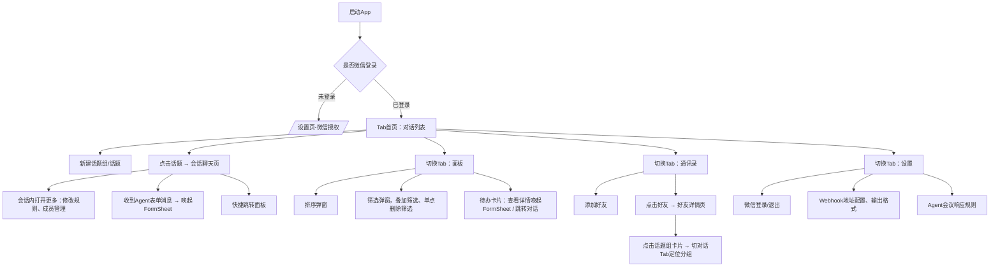

# 《多人轻重Agent协同研讨App｜完整UI交付包》
> 项目名称：砚谈（暂定名，贴合宣纸、研讨、Agent纪要质感）
> 载体：Flutter 移动端｜竖屏手机优先
> 视觉基调：宣纸白底色、轻拟物、低饱和水墨棕灰，参考微信信息流交互范式
> 架构底座：OpenIM Flutter SDK
> 核心机制：轻重双层Agent + HITL Webhook表单断点 + 自由/罗伯特轮训双议事模式
> 交付物合集：
> 1. 全局设计规范（色值/字体/组件/动效）
> 2. 页面清单 + 路由表
> 3. 逐页UI详情（布局、元素、文案、状态、交互）
> 4. 页面跳转流程图（文本结构化，可直接转Figma）
> 5. Figma标注清单（组件命名、尺寸、约束）
> 6. Flutter开发侧页面&组件清单、常量定义
> 7. 异常/空态/加载态规范
> 8. PRD联动校验清单

---

## 1. 全局设计规范
### 1.1 色彩规范（可直接录入Figma样式库）
| 用途 | 色值 | 备注 |
|---|---|---|
| 页面基底（宣纸底色） | `#FCFAF4` | 全局页面背景，底层叠加极低透明度纸张噪点纹理 |
| 卡片底色 | `#F8F5EC` | 会话卡片、待办卡片、弹窗面板 |
| 主文本 | `#3A3630` | 标题、正文、消息主体 |
| 次要文本/提示文字 | `#726B62` | 副标题、说明、占位文字 |
| 强调色（新增、确认、提交、跳转） | `#946B48` | 赭石浅棕，不刺眼，主按钮、选中态 |
| 分割线、边框 | `#E8E2D7` | 浅棕灰细线 |
| 禁用态 | `#C8C2B7` | 不可点击选项、置灰操作 |
| 人消息气泡 | `#F4F0E6` | 对话用户气泡 |
| Agent消息气泡 | `#E9EDEB` | 轻度Agent消息，淡青灰区分 |
| 筛选标签默认 | `#F0EBE1` | 胶囊筛选组件 |
| 筛选标签激活 | `#946B48` | 文字反白 |
| 遮罩层 | `rgba(30,28,24,0.45)` | 底部Sheet、弹窗遮罩 |

### 1.2 字体规范（移动端sp单位）
> Flutter使用系统Sans，不引入额外字体包，保障跨平台
- 页面大标题：18sp，Medium
- 卡片标题/会话标题：16sp，Regular
- 正文、消息内容：14sp，Regular
- 辅助小字、时间、标签：12sp，Regular
> 行高：标题1.3，正文1.4

### 1.3 轻拟物统一规则（重点，区别于扁平化）
1. 卡片：**微弱下沉阴影** `0 1px 3px rgba(90,75,60,0.08)`，无厚重投影；圆角 12px
2. 输入框、表单输入项：轻微内凹质感，边框 `#E8E2D7`，圆角 8px
3. 按钮：默认微凸起；点击态下压，阴影消失；圆角 10px
4. 底部Tab图标：线稿风格，水墨线条，选中色=赭石 `#946B48`
5. 禁止渐变、发光、高饱和色彩，保持纸张素雅感

### 1.4 全局通用组件库
| 组件名称 | 用途 |
|---|---|
| SessionGroupCard 话题组卡片 | 对话Tab一级分组 |
| TopicCard 话题卡片 | 组内会话条目 |
| TodoCard 待办卡片 | 面板Tab任务 |
| FilterChip 筛选胶囊 | 多条件筛选，支持单个删除 |
| FormSheet HITL表单底部弹窗 | Webhook下发表单面板 |
| FriendItem 好友条目 | 通讯录列表 |
| SettingCell 设置表单项 | 设置页通用行 |
| MessageBubble 消息气泡 | 会话流，区分人/Agent |
| StateTag 状态标签 | 待确认/执行中/已完成 |

### 1.5 动效规范
- 页面切换：左右平滑推拉（标准移动端）
- 底部表单Sheet：从底部向上缓动弹出，ease-out，时长240ms
- 话题组折叠展开：高度插值动画 200ms
- 筛选标签新增/移除：淡入淡出+缩放 150ms
- 按钮点击：下压反馈，无震动（可选开启轻震动配置）

### 1.6 常驻底部Tab（4个，全局固定）
顺序：**对话｜面板｜通讯录｜设置**
图标文案：
1. 对话：对话气泡图标 + 文字「对话」
2. 面板：清单面板图标 + 文字「面板」
3. 通讯录：联系人图标 + 文字「通讯录」
4. 设置：齿轮图标 + 文字「设置」

---

## 2. 路由清单（Flutter路由命名，结构化）
```
/                 // 首页，默认进入对话Tab
/tab/chat          // Tab1 对话列表页
/chat/group/create // 新建话题组弹窗
/chat/topic/create // 新建话题弹窗
/chat/session      // 会话详情页（话题聊天页）
/chat/session/rule // 会话规则弹窗：切换自由/轮训模式、成员管理

/tab/taskboard     // Tab2 面板（任务看板）
/taskboard/sort    // 排序选择弹窗
/taskboard/filter  // 多条件筛选弹窗
/task/form_sheet   // HITL表单底部弹窗（全局可唤起）

/tab/contact       // Tab3 通讯录列表
/contact/detail    // 好友详情页（展示TA参与的话题组）

/tab/setting       // Tab4 设置页
/setting/webhook   // 重度Agent Webhook配置（内嵌在设置页）
/setting/agent_rule// Agent会议响应规则配置（内嵌）
```

---

## 3. 逐页UI详细设计
### 📄 Page1：/tab/chat 【对话列表页｜默认首页】
**页面分区：顶部导航栏 + 新建按钮 + 话题折叠列表区**
1. 顶部导航
    - 左：无
    - 中间标题：对话
    - 右侧：`+` 新增按钮，点击弹出ActionSheet
      - 选项①：新建话题组
      - 选项②：新建话题
2. 主体：折叠分组列表
    - 初始固定分组：【新组】
      - 展开内默认子项：【新话题】
    - 话题组卡片（一级）
      - 左：组头像（多头像堆叠，右下角小Agent标识）
      - 中：组名称；长按唤起菜单：重命名、添加好友、删除组
      - 右：展开箭头 + 成员计数（计数包含Agent）
    - 话题卡片（组内二级子项）
      - 左：话题标记图标
      - 中：话题标题（默认取自Agent首轮总结，支持长按重命名）
      - 副标题小字：`模式：自由 / 轮训（罗伯特议事法则）` + 消息预览
      - 右：消息时间、未读红点
    - 点击话题卡片 → 进入会话详情页
3. 空态：无自定义话题组时，仅保留【新组-新话题】，不展示空提示
4. 加载态：列表骨架屏（卡片骨架）

#### 📄 Page1-1：/chat/session 【会话聊天页】
1. 顶部导航栏
    - 返回箭头
    - 标题：话题名称
    - 右侧「···更多」菜单
      - 菜单选项：修改话题名称、切换讨论模式、管理成员、跳转面板看板
    - **轮训模式专属顶部提示条**（仅轮训打开时常驻）
      - 文字示例：`【轮训模式生效｜等待发言人】` / `【Agent本轮发言位】`
2. 消息流区域
    - 消息气泡两种样式：用户气泡 / Agent气泡
    - 特殊消息类型：**表单任务卡片消息**
      - 卡片标题：【Agent待确认表单】
      - 内容预览：字段摘要
      - 按钮：【打开表单面板】→唤起FormSheet
      - 业务双通路：
        ① 用户手动打开面板填写提交
        ② 用户自然语言聊天，轻度Agent自动填充表单，卡片提示「已自动填充表单，是否确认提交」
3. 底部输入区
    - 附件图标（图片、文件）
    - 输入框
    - 发送按钮
4. 规则约束：Agent是话题组默认成员，成员列表中灰色、不可移除；添加好友弹窗从通讯录选人

### 📄 Page2：/tab/taskboard 【面板｜任务看板】
1. 顶部导航栏
    - 标题：面板
    - 右侧并排按钮：【排序】【筛选】
2. 筛选胶囊栏（**有激活筛选条件才渲染**）
    - 每一个胶囊右侧带 ×，点击单独移除本条筛选
    - 支持叠加多条件：所属话题组、所属话题、任务状态
3. 主体：待办卡片列表
    - TodoCard字段：
      - 左上角状态标签：待确认 / 执行中 / 已完成
      - 任务标题
      - 元信息：所属话题组｜所属话题｜截止时间｜★重要性标记
      - 底部操作按钮：【查看详情】【跳转对话】
    - 【查看详情】→唤起FormSheet表单面板
    - 【跳转对话】→直接打开来源会话页
4. 弹窗：排序弹窗（单选）
    - 按重要性（高→低）
    - 按截止时间（近→远）
    - 按所属话题/话题组
5. 空态页面：宣纸背景，居中文字「暂无待办任务，发起对话生成任务」
6. 加载态：卡片骨架屏

### 📄 Page3：/tab/contact 【通讯录列表页】
1. 顶部导航栏
    - 标题：通讯录
    - 右上角：【+ 添加好友】
2. 顶部搜索框：占位提示「搜索好友昵称」
3. 好友列表：条目 = 头像 + 昵称
    - 点击好友条目 → 跳转好友详情页
    - Agent不出现在通讯录列表（Agent是组内置成员，不是可添加好友）
4. 空态：「暂无好友，点击右上角添加」

#### 📄 Page3-1：/contact/detail 【好友详情页】
1. 顶部：返回箭头
2. 头部信息区：大头像、好友昵称
3. 分区标题：TA参与的话题组
4. 话题组卡片列表：组名、成员预览
5. 点击任意话题组卡片：**自动切到对话Tab，定位并展开该话题组**

### 📄 Page4：/tab/setting 【设置页】
垂直流式设置Cell，分区分割
1. 分区1：登录信息（微信社会化登录）
    - 头像+昵称展示块
    - 说明文字：头像、昵称由微信授权获取
    - 按钮：重新授权登录｜退出登录
2. 分区2：重度执行Agent设置
    - Cell1：Webhook钩子地址
      - 单行输入框，占位：`填写重度Agent回调Webhook地址`，支持复制粘贴
    - Cell2：重度Agent回复格式（单选组）
      - ○ 自然文本
      - ○ 简要摘要
      - ○ JSON结构化（表单任务优先JSON）
3. 分区3：Agent会议规则设置（全局默认，新建话题组自动继承；会话内可单独覆盖）
    - 标题：Agent响应规则（轮训模式下完整生效）
    - 单选：
      - ▢ 回应所有人
      - ▢ 只回应主持人
      - ▢ 参与轮训（每轮作为最后一名发言，负责总结、接收指令）
4. 分区4：其他
    - 清除本地缓存
    - 关于砚谈
    - 版本号

### 🧩 全局浮动组件：FormSheet HITL表单面板（最重要业务组件）
- 唤起方式：底部上滑Sheet，遮罩背景
- 容器：宣纸卡片，圆角上16px，下0px
- 内容区：动态渲染表单字段（文本输入、单选、日期选择、星级重要性、截止时间）
- 提示条（自动填充时出现）：橙色浅条 `已从对话自动填充，可修改后提交`
- 底部操作栏：【取消】｜【提交给Agent】
- 关闭方式：点击遮罩、取消按钮、提交成功自动关闭

---

## 4. 页面跳转流程图（结构化，给产品/UI/开发对齐）


---

## 5. Figma标注交付清单（直接交付UI设计师）
### 5.1 页面Frame清单（建议Figma页面命名）
1. 00_Design_Token 设计令牌（色值、字体、阴影、圆角）
2. 01_Tab_Chat 对话列表页
3. 02_Session_Chat 会话聊天页
4. 03_Tab_Taskboard 面板任务看板
5. 04_Tab_Contact 通讯录列表
6. 05_Contact_Detail 好友详情
7. 06_Tab_Setting 设置页面
8. 07_Component_Library 组件库（所有原子组件）
9. 08_States 空态/加载/异常状态
10. 09_Flow 跳转流程图

### 5.2 组件命名规范（Figma组件命名，BEM）
```
Card/SessionGroup
Card/Topic
Card/Todo
Item/Friend
Chip/Filter
Bubble/User
Bubble/Agent
Sheet/Form
Cell/Setting
Tag/State
Button/Primary
Input/Text
Tab/Bottom
```
### 5.3 间距规范（基准8px栅格系统）
- 页面左右边距：16px
- 卡片内边距：12px
- 卡片上下间距：10px
- 组件内部垂直间距：8px / 16px 二档

---

## 6. Flutter开发常量&枚举清单（直接给前端）
```dart
// 颜色常量
const Color paperBg = Color(0xFFFCFAF4);
const Color cardBg = Color(0xFFF8F5EC);
const Color textMain = Color(0xFF3A3630);
const Color textSub = Color(0xFF726B62);
const Color accent = Color(0xFF946B48);
const Color divider = Color(0xFFE8E2D7);
const Color disable = Color(0xFFC8C2B7);
const Color bubbleUser = Color(0xFFF4F0E6);
const Color bubbleAgent = Color(0xFFE9EDEB);

// 讨论模式枚举
enum TalkMode { free, robert }
// Agent回复格式枚举
enum AgentReplyFormat { natural, brief, json }
// Agent响应策略枚举
enum AgentReplyPolicy { replyAll, replyHost, joinRound }
// 任务状态枚举
enum TodoStatus { pendingConfirm, running, finished }
```

---

## 7. 状态兜底规范（空态、加载、错误）
1. 加载态：全局统一骨架屏，卡片灰度占位，不使用Loading转圈为主
2. 网络异常：页面顶部悬浮提示条，浅赭色背景；提示「网络异常，请检查连接」
3. Webhook调用失败：在会话内发送Agent提示消息：「重度Agent服务调用失败，请检查Webhook配置」
4. 表单提交失败：FormSheet内红色提示，保留已填写内容不丢失
5. 权限拒绝（微信授权）：设置页提示「微信授权失败，无法获取头像昵称」

---

## 8. PRD联动校验清单（UI和业务逻辑对齐核对表）
✅ 话题组支持添加好友，Agent默认内置成员不可移除
✅ 话题标题默认取Agent首轮总结，支持手动修改
✅ 会话内切换自由模式 / 罗伯特轮训模式
✅ 面板看板：多筛选叠加、单个筛选标签独立删除
✅ 排序选项：重要性 / 截止时间 / 话题分组
✅ 通讯录点击好友，展示TA全部话题组，一键跳转对话Tab定位
✅ 设置页：Webhook地址、输出格式、Agent会议响应规则
✅ HITL表单双通路：手动填写 / 轻度Agent自然语言自动填充
✅ 整体视觉：宣纸白底，轻拟物，微信式信息流竖屏布局
✅ 底层IM：OpenIM Flutter SDK承载消息、附件、图片

---

# 后续可选延伸交付
如果你需要，我可以继续输出两份材料：
1. 配套 **交互说明文档（给测试用）**：每个按钮、异常场景的验收用例
2. 一份给后端的 **消息体、表单JSON Schema 规范文档**（和UI表单一一对应）

你看是否继续产出？
